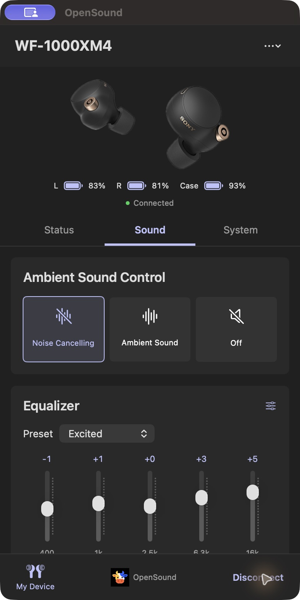
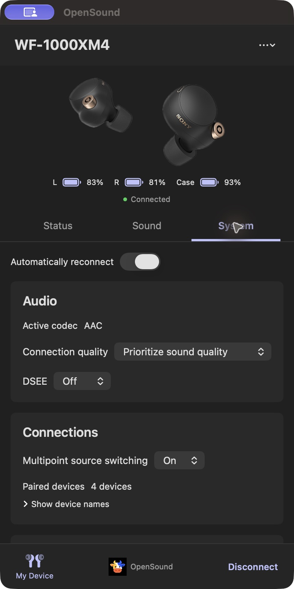
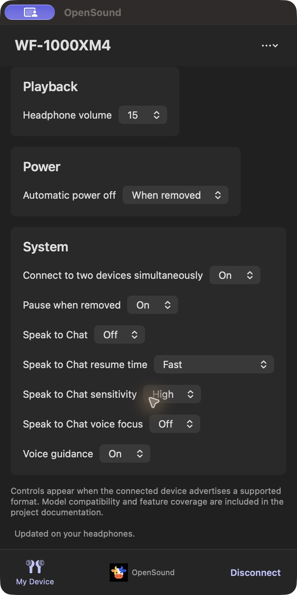
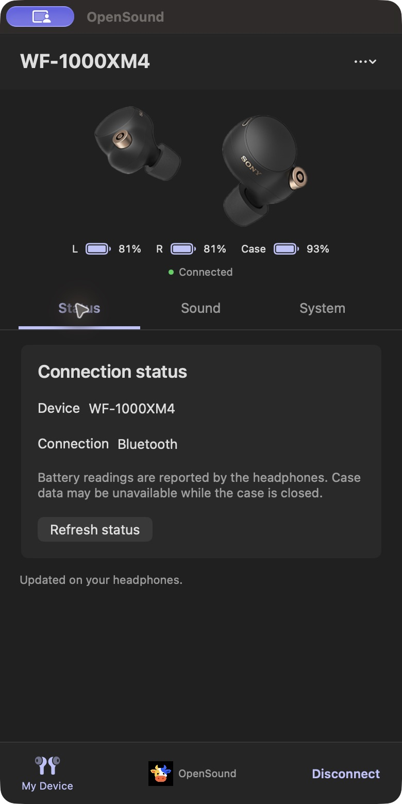

<p align="center">
  
</p>

# OpenSound

[](https://github.com/noppakorn001/OpenSound/actions/workflows/build.yml)
[](LICENSE)
[](#build-and-test)

An independent, open-source macOS controller for Sony Bluetooth headphones. It uses a portrait window and an English interface inspired by Sound Connect. Original headphone controls are reconstructed using packet evidence and MIT protocol references; the app does not execute the iOS binary.

## Interface

Real screenshots from OpenSound connected to a WF-1000XM4. Battery values and available controls depend on the device. Product pictures match known models; paired-device names are collapsed for privacy.

| Sound | System |
|---|---|
|  |  |

| Device settings | Status |
|---|---|
|  |  |

The Menu Bar headphone icon keeps quick battery, ANC/EQ, connection, reconnect preference and window controls available while the main window is closed. See the [interface guide](docs/INTERFACE.md) for each section.

**Left/right actions:** In System → Button and touch controls, choose both actions and click **Apply touch controls**. OpenSound verifies the whole pair. On the tested WF-1000XM4 configuration, keep Playback control on one side; selecting Left Playback allows Right Ambient, Volume or No function. See the [paired editor guide](docs/INTERFACE.md#button-and-touch-controls).

## Run

Download the `.dmg` from [GitHub Releases](https://github.com/noppakorn001/OpenSound/releases), open it and drag **OpenSound** to **Applications**. See the [installation guide](docs/INSTALLATION.md), including the current ad-hoc signing and notarization limitations.

Open `dist/OpenSound.app`. Pair your headphones in macOS System Settings → Bluetooth, then choose Connect. The More menu selects a paired device or refreshes devices. Allow Bluetooth access if macOS requests it.

The headphone icon in the macOS Menu Bar provides battery status, connection actions, ANC modes, EQ presets and **Show OpenSound**. The same shortcuts are available in the app's **Controls** menu. Closing the main window keeps the app running; choose **Quit OpenSound** from the Menu Bar to stop it and release the control session. No start-at-login item is installed.

**Automatically Reconnect** resumes a control connection to the headset you selected after a connection loss or Mac wake. Retry delays are 2, 5, 10, 20, 30 and then 60 seconds. A manual Disconnect suspends automatic connection until you connect again. The app remembers the last selected Bluetooth address and connection preference locally in macOS user preferences; these are never uploaded. Disable reconnect in System or the quick menu. Reconnect reads current headphone state and never replays old sound settings.

The Sound tab provides supported ANC / Ambient / Off modes, advertised EQ presets, and the five-band / Clear Bass editor when its format is compatible. Changes are confirmed by device readback. The System tab displays additional controls and device information selected by the connected headphone's capabilities. Missing battery readings display **Unavailable**. Controls with unknown formats stay disabled and show the reason.

WF-1000XM4 firmware 2.3.1 is the physical test device. Discovery and protocol selection are model independent, but **all Sony models and all Sound Connect functions are not yet verified or implemented**. See [device support](docs/DEVICE_SUPPORT.md) and [feature coverage](docs/FEATURE_COVERAGE.md) for the exact boundaries. A function appearing in the IPA catalogue is not proof that it works in this app. Cloud/account services and firmware updating are excluded from this release.

## Build and test

New contributors: follow the [development guide](docs/DEVELOPMENT.md) for a clean build, source map, checks and release packaging.

Requires Apple Silicon, macOS 14 or later, and Xcode with the Swift / C++ toolchain.

```sh
./scripts/build.sh
./scripts/test.sh
python3 tests/FeatureCatalogTests.py
python3 tests/SourceExportTests.py
bash scripts/security-test.sh
python3 scripts/check-public-privacy.py
bash scripts/package-dmg.sh
```

The build uses local ad-hoc signing. Neither Node, Java, Ghidra, PlayCover, the IPA, nor a paid developer account is needed to build or run. The included ICNS icon is ready to build; `scripts/build-icon.sh` regenerates it from the original PNG using macOS tools.

`scripts/hardware-test.sh` is an optional live test: it temporarily changes ANC/EQ and restores the saved settings with readback. Close other controller sessions before running. Hardware testing is distinct from offline protocol tests.

## Contribute

See the [open-source readiness review](docs/OPEN_SOURCE_READINESS.md) for verified build/export checks and the remaining artwork limitation.

You can [fork this repository](https://github.com/noppakorn001/OpenSound/fork), modify the MIT-licensed code and submit a pull request without asking permission. See [CONTRIBUTING.md](CONTRIBUTING.md), [support](SUPPORT.md) and [community conduct](CODE_OF_CONDUCT.md). Protocol fixtures, model reports, and patches for missing capability formats are welcome. Include exact model, firmware, protocol table, advertised functions, and reproducible readback evidence; omit Bluetooth addresses and personal information. Public feature metadata is in `docs/feature-catalog.json`; its provenance and limitations are described in [REVERSE_ENGINEERING.md](docs/REVERSE_ENGINEERING.md).

`scripts/package-source.sh` produces an allowlisted source archive without the IPA, extracted files, raw captures, device addresses, development tools, vendor checkouts, or app binaries. It also creates a clean source directory under `dist`. The research workspace must not be published wholesale.

The [publication privacy guard](docs/PUBLICATION_PRIVACY.md) checks tracked files, reachable Git history, image metadata and commit email addresses. Enable the local pre-push check with `git config --local core.hooksPath .githooks`. Review screenshots manually as well; automated checks do not recognize every possible personal detail.

**License scope:** Original code, documentation and the owner-provided cow logo are MIT-licensed. **Sony product-render redistribution rights remain unconfirmed**, including their depiction in screenshots; those images are excluded from the MIT grant and retained at the owner's request. Forks can omit them with `OPENSOUND_DEVICE_IMAGES=none bash scripts/build.sh`. Read [licensing and artwork](docs/LICENSING.md) before redistributing artwork.

Third-party attribution is retained in [THIRD_PARTY_NOTICES.md](THIRD_PARTY_NOTICES.md). OpenSound is not affiliated with Sony. The active app icon is the colorful geometric cow logo selected and supplied by the project owner. Asset provenance is retained in `Resources/Icon/PROMPT.txt`. Device product renders match known models; their source is documented in `Resources/Devices/NOTICE.md`. No assets extracted from the supplied IPA are included.

Read the [missing features audit](docs/MISSING_FEATURES.md), [security review](docs/SECURITY_REVIEW.md) and [security policy](SECURITY.md). This OpenSound headphone app is separate from existing projects using the same name, including [opensound-org/opensound](https://github.com/opensound-org/opensound) and [luckyshot/OpenSound](https://github.com/luckyshot/OpenSound).
