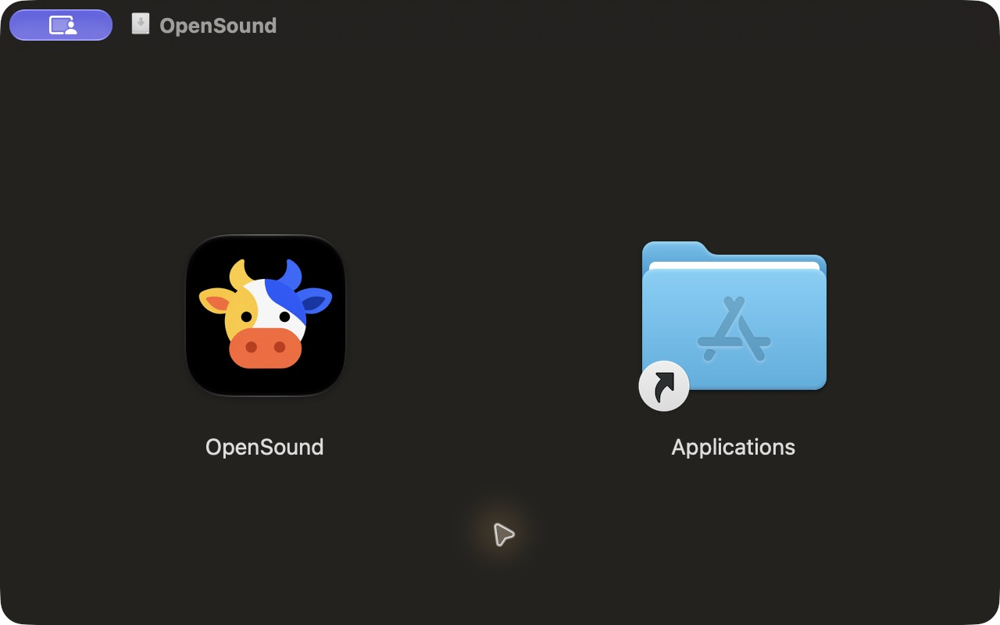

# Install OpenSound

Requires Apple Silicon and macOS 14 or later. Download the versioned `.dmg` from [GitHub Releases](https://github.com/noppakorn001/OpenSound/releases).



1. Double-click the DMG to open it.
2. Drag **OpenSound** onto **Applications** in the installer window.
3. Eject the OpenSound disk image.
4. Open **OpenSound** from Applications and allow Bluetooth access if macOS asks.
5. Pair your Sony headphones in System Settings and connect from OpenSound.

The app stays in the Menu Bar when its window is closed. Choose **Quit OpenSound** before replacing an installed version. Replacing the app does not change the headphone settings or delete the app's local preferences.

## Signing

This release is ad-hoc signed with hardened runtime. It is **not Developer ID signed or notarized**. A downloaded copy may be blocked by Gatekeeper on first launch. Review the source and download provenance before deciding whether to allow it; follow [Apple's instructions for opening apps safely](https://support.apple.com/en-us/102445). Do not disable Gatekeeper globally. A seamless notarized release needs a Developer ID certificate and Apple's notarization service, which are not configured for this project.

The DMG includes a SHA-256 sidecar file. Verify it from the download folder with `shasum -a 256 -c OpenSound-0.4.0-macos-arm64.dmg.sha256`. A matching checksum verifies downloaded bytes, not publisher identity or notarization.

## Build an installer

```sh
bash scripts/build.sh
bash scripts/package-dmg.sh
```

The checked-in Finder layout template contains only fixed window preferences and app/folder icon positions. It contains no user paths, account names or background-file aliases. Regenerating it is optional and uses build-only Python packages:

```sh
python3 -m pip install --target build/dmg-tools ds_store==1.3.1 mac_alias==2.2.2
python3 scripts/create-finder-layout.py
```

The installed app does not contain those dependencies, the IPA, private captures, authentication configuration or device preferences.
